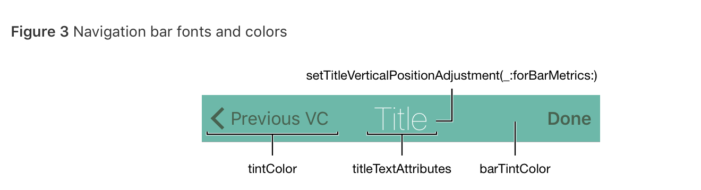

Swift30Projects-05-CandySearch 的一些经验总结。

### Color 设置
在这个项目里我遇到的一个大问题就是在`NavigationController` - `UITableViewController` - `UITableViewController` 其中还包括 `UISearchController` 的结构中各种颜色设置问题。搜索了很多，也摸索了很多，在这里总结一下。



这张图可以清晰的看出一个 navigation Bar 上面的各种视图包括：返回按钮，背景，标题，分别由哪种属性定义

#### 代码方法：
当你的 App 具有统一的 UI 的时候，可以直接在 `AppDelegate.swift` 的 

```swift
func application(_ application: UIApplication, didFinishLaunchingWithOptions launchOptions: [UIApplicationLaunchOptionsKey: Any]?) -> Bool 
```
方法中进行全局设置，当然你也可以在子视图中通过
self.navigationController.navigationBar.tintColor 类似这样子的方式进行单独的定义，若没有单独定义，那么子视图的设置将会与父视图一致。

在本 App 中，我添加了一个 `UIColor` 的 extension 

```swift
extension UIColor {
    static func candyGreen() -> UIColor {
        return UIColor(red: 67/225, green: 205/255, blue: 135/255, alpha: 1)
    }
```
然后，进行颜色的设置：

```swift
    func application(_ application: UIApplication, didFinishLaunchingWithOptions launchOptions: [UIApplicationLaunchOptionsKey: Any]?) -> Bool {
        
        UINavigationBar.appearance().barTintColor = UIColor.candyGreen()
        UINavigationBar.appearance().tintColor = .white
        UINavigationBar.appearance().titleTextAttributes = [NSAttributedStringKey.foregroundColor : UIColor.white]
       
        return true
    }
```

因为 App 中有一个 `UISearchController`, 所以需要对 `SearchBar` 的颜色进行设置，其中 `barTintColor` 代表搜索条的**背景颜色**， `tintColor` 代表🔍栏处于编辑状态时，Cancel 按钮，光标，以及 `scopeButton`的颜色，在本 App 中设定为白色，但此时有一个问题，就是🔍栏的光标设为白色时，打字就无法显示光标，这显然很不友好，把它设为 `barTintColor` 的颜色是一种友好的解决方案，于是在上面代码的结尾处再加上

```swift
 UISearchBar.appearance().barTintColor =  UIColor.candyGreen()
 UISearchBar.appearance().tintColor = UIColor.white
 UITextField.appearance(whenContainedInInstancesOf: [UISearchBar.self]).tintColor = UIColor.candyGreen()
```

#### StoryBoard设置: 
与代码方法比较，在 StoryBoard 中设置比较简单，但是不如代码直观，而且似乎有些属性的颜色无法在 StoryBoard 设置，例如 navigationItem 的 title, 可能因为它不是一个视图吧？
Navigation Bar 背景色：Navigation Bar -> Bar Tint
Navigation Bar 返回按钮：Navigation Bar -> View -> Tint
至于 `UISearchBar`, 由于本 App 是直接写代码通过 `UISearchController` 创建，在 StoryBoard 里也无法设置

### Search Related 
在这个 project 中重点学习了在 TableView 中添加搜索功能的一些方法实现

* searchController 的设置：

```swift
let searchController = UISearchController(searchResultsController: nil)

override func viewDidLoad() {
        
        super.viewDidLoad()
        
        searchController.searchResultsUpdater = self
        searchController.dimsBackgroundDuringPresentation = false
        definesPresentationContext = true
        tableView.tableHeaderView = searchController.searchBar
  }

```
* 在 tableView 的 dataSource 方法中 通过 `searchController.isActive` 来决定 cell 的配置

* 
```swift
func updateSearchResults(for searchController: UISearchController)
```
用来实时显示搜索结果
* 
```swift
func searchBar(_ searchBar: UISearchBar, selectedScopeButtonIndexDidChange selectedScope: Int)
```
用来进行分类搜索，其中不要忘记设置

```swift
searchController.searchBar.delegate = self
```

* **一个重要的环节**就是当 TableView 展示出正确的搜索结果，点击 cell, 展示 DetailViewController 的时候，记得在 `prepare(for segue)` 方法中使用搜索后的结果，因为此时 `indexPath` 已经完全不一样


