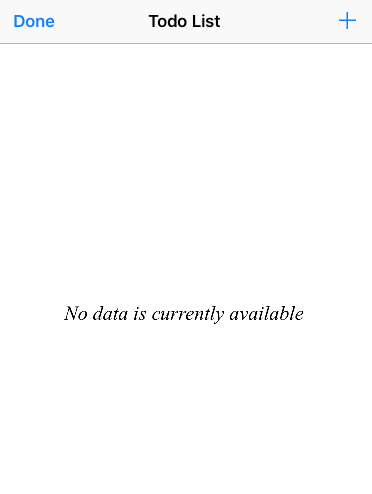

Swift30Days-03-ToDo, 在学习的过程中想总结一下一个简单的 ToDo 应用，如何简洁，优雅的实现删除，排序功能。以及当没有 Data 时，展示 No Data Available 页面的代码实现。

### Edit Mode

在实现的过程中，尝试了很多方法，例如在 StoryBoard 中添加一个 `NavigationBarItem`, 然后关联一个动作，发现不但要处理 Edit/Done 两种不同状态的逻辑，而且单单是按钮在 Edit/Done 里那种状态的转换，就让初学的我大伤脑筋。用纯代码的方式，分别创建 Edit, Done 两个 Button, 代码也是特别复杂。在 Stackoverflow 和 谷歌搜索良久，终于发现了一个优雅的实现方法！

> editButtonItem：Returns a bar button item that toggles its title and associated state between Edit and Done.
> Discussion: If one of the custom views of the navigationItem property is set to the returned object, the associated navigation bar displays an Edit button if isEditing is false and a Done button if isEditing is true. The default button action invokes the setEditing(_:animated:) method.

踏破铁鞋无觅处，得来全不费工夫。原来 `UIViewController` 自身就有一个这样子的属性, Cocoa 已经全部帮你实现好了其基本的功能。所以只需要

```swift
navigationItem.leftBarButtonItem = self.editButtonItem
```
就可以创建好这个 Edit Button。
接下来需要做的就只是具体实现删除，排序两个方法。只需要 override 

```swift
 override func tableView(_ tableView: UITableView, commit editingStyle: UITableViewCellEditingStyle, forRowAt indexPath: IndexPath) 
```

```swift
 override func tableView(_ tableView: UITableView, commit editingStyle: UITableViewCellEditingStyle, forRowAt indexPath: IndexPath) {
        if editingStyle == .delete {
```
这两个 `UITableViewDataSource` Protocol Method 就好了，实现的方法也十分简单，先对数据进行操作，再对视图进行操作使其展示正确的数据，这是一个基本原则。

### No Data BackGroundView



一个 `TableView` 当没有数据的时候，展示一个 "No data currently Availabel" 的视图，当添加上数据的时候，再重新展示一个 TableView 是一个很友好的体验。在这个过程中，其思路是通过判断 `numberOfSections`, 当没有数据的时候，section   数量为0，重新设定 backgroundView, 当有数据的时候，section 数量为一。 具体代码如下：

```swift
 override func numberOfSections(in tableView: UITableView) -> Int {
        
        var numbOfSections = 0
        if todoList.count != 0 {
            numbOfSections = 1
            tableView.separatorStyle = .singleLine
            tableView.backgroundView = nil
            
        } else {
            let noDataLabel = UILabel(frame: CGRect(x: 0, y: 0, width: tableView.bounds.size.width, height: tableView.bounds.size.height))
            noDataLabel.text = "No data is currently available"
            noDataLabel.font = UIFont(name: "TimesNewRomanPS-ItalicMT", size: 20.0)
            noDataLabel.textAlignment = .center
            tableView.backgroundView = noDataLabel
            tableView.separatorStyle = .none
        }
        return numbOfSections
    }
```
一切都运行正常，当视图一开始没有数据的时候，TableView 会展示一个提示，当添加一个数据的时候，会重新出现一行行的 cell。但是我发现当删除最后一行 cell 的时候，程序崩溃了！
经过查看 Log 和 搜索，发现原来当 `tableView.deleteRows(at: [indexPath], with: .top)` 删除最后一行 cell  的时候，numberofSections 就变成了0，然而 deleteRows 并不会删除 Section，所以程序崩溃掉了。一个简单的做法就是在对数据操作完成后，直接 `tableView.reloadData()` 但是这样一是面对数量较大的视图的时候，特别的耗费性能，其次这样子无法展示 rows 被删除的动画效果，给人感觉太突兀。所以这绝对算不上一个好的解决方法。正确的做法是在本方法内调用 `deleteSections` 方法, 具体如下：

```swift
    override func tableView(_ tableView: UITableView, commit editingStyle: UITableViewCellEditingStyle, forRowAt indexPath: IndexPath) {
        if editingStyle == .delete {
            todoList.remove(at: indexPath.row)
            if todoList.count == 0 {
                tableView.deleteSections(IndexSet(integer: indexPath.section), with: .automatic)
                return
            }
            tableView.deleteRows(at: [indexPath] , with: .bottom)
        }
    }
```
这样子，问题就得到解决了。


